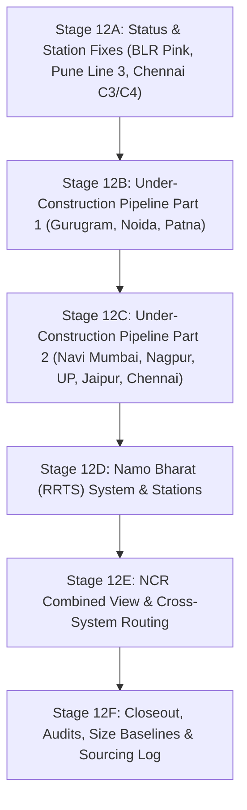

# Phase 12 — Part 1: Read-Only Inventory and Implementation Plan

**Date:** 2026-11-23  
**Repo:** `indian-metro-tracker`  
**Base:** `origin/master` (Commit `a60d25a`)  
**New Branch:** `phase-12-ncr-and-gaps`  

---

## 1. Repo State and Baseline Audit

### 1.1 Branch State & Merge Status
- **Current Branch:** `phase-12-ncr-and-gaps` (branched directly from `origin/master` at `a60d25a`).
- **Phase-10 Status (`phase-10-gap-closing`):** Fully merged into `master`. (`git branch --contains phase-10-gap-closing` includes `master`; `git log master..phase-10-gap-closing` is empty).
- **Phase-11 Status (`phase-11-sourced-approvals`):** Fully merged into `master` (merged via commit `a44de53` followed by code prune `a60d25a`).
- **Working Tree Status:** Clean (no uncommitted file modifications).

### 1.2 Test Suite Execution
- **Command:** `npm run test` (Vitest v3.2.7)
- **Result:**
  ```text
  Test Files  50 passed (50)
       Tests  445 passed (445)
    Duration  33.80s
  ```

### 1.3 TypeScript & Linting Checks
- **Command:** `npm run typecheck; npm run lint`
- **Result:** Clean exit (code 0), zero TypeScript compiler errors, zero ESLint warnings or errors.

### 1.4 Data Validation (`validate:data`)
- **Command:** `npm run validate:data`
- **Result:**
  ```text
  ✅ Validation Successful!
     • Cities loaded: 22
     • Lines loaded: 59
     • Segments loaded: 79
     • Stations loaded: 954
     • Fare rules loaded: 2
     • Service hours loaded: 0
  All schema and relational integrity checks passed.
  ```

### 1.5 Static Size & Gzip Baselines (`measure:size`)
- **Command:** `npm run measure:size`
- **Raw Measurements:**
  | Metric | Current Measured | Recorded Limit | Headroom Remaining |
  | :--- | :--- | :--- | :--- |
  | **Runtime Data Gzip** | 148,738 B | 149,492 B | +754 B (Safe) |
  | **Homepage Initial JS** | 317,210 B | 317,830 B | +620 B (Safe) |

### 1.6 Data Audit (`audit:data`)
- **Report Date:** `reports/data-audit/2026-11-22.json`
- **Summary:**
  - **Errors:** 3
    1. `bhopal`: `city-km-vs-reference` (variance 10.2%: computed 5.58 km vs reference 6.22 km; known pending rule PRE-01).
    2. `gurugram`: `line-terminal-missing` (Cyber City loop station 1904 m from segment end; known pending rule PRE-02).
    3. `patna`: `declared-not-compiled` (`pat-blue|Corridor 2 Underground (Patna Junction - Malahi Pakri)` declared in reference without compiled segment or coverage-gap link).
  - **Warnings:** 1,207
  - **Info:** 25
  - **Accepted Warnings (Baselined):** 1,037
  - **Unreviewed Warnings:** 80
  - **Pending Rule Findings:** 41
  - **Documented Coverage Gaps:** 15

---

## 2. Gap Inventory

### 2a. Pune Line 3 (Pink Line, Hinjewadi–Shivajinagar)
- **Current Repo Contents:**
  - `data/lines.json`: Line `pun-line-3` ("Pink Line (Line 3)", operator: PITCMRL, color: `#FF69B4`).
  - `data/segments.geojson`: `pun-line-3-seg-01` (status: `operational`, length: 20.29 km, 455 vertices).
  - `data/stations.geojson`: **13 stations**, all marked `operational`:
    `pune-district-court`, `pune-balewadi-stadium`, `pune-maan`, `pune-infosys`, `pune-agriculture-college`, `pune-wipro`, `pune-wakad-chowk`, `pune-savitribai-phule-pune-university`, `pune-yashada`, `pune-krushi-anusandhan`, `pune-nicmar`, `pune-jakat-naka`, `pune-hinjawadi`.
- **Expected Real-World Total:** 23 stations.
- **Root Cause of Missing 10 Stations:**
  In `data/overrides/pune.json`, the station overrides explicitly placed 6 valid OSM-mapped Line 3 stations into `out_of_scope_station_ids`:
  `pun-high-street`, `pun-balewadi-phata`, `pun-baner-gaon`, `pun-baner`, `pun-rbi`, `Line 3 Shivajinagar`.
  Additionally, `Doehler India` (Maan Bus Depot) is in `data/raw/pune.json` (node `7944584965`) but omitted.
- **Detailed 23-Station Inventory:**
  | # | Station Name | In Repo? | Coordinates Source | Status & Notes |
  |---:|:---|:---:|:---|:---|
  | 1 | Maan (Megapolis) | Yes | Surveyed (`stations.geojson`) | Operational |
  | 2 | Maan MIDC Circle Phase II | No | Missing named node | Surveyed node absent in OSM cache |
  | 3 | Maan Bus Depot (Doehler India) | No | Surveyed node in raw cache (`7944584965`: [73.70290, 18.58810]) | Omitted by override |
  | 4 | Infosys | Yes | Surveyed (`stations.geojson`) | Operational |
  | 5 | Wipro | Yes | Surveyed (`stations.geojson`) | Operational |
  | 6 | Padmabhushan Chowk (Pall India) | No | Missing named node | Surveyed node absent in OSM cache |
  | 7 | Chhatrapati Shivaji Chowk | No | Missing named node | Surveyed node absent in OSM cache |
  | 8 | Hinjawadi (Hinjawadi Chowk) | Yes | Surveyed (`stations.geojson`) | Operational |
  | 9 | Jakat Naka | Yes | Surveyed (`stations.geojson`) | Operational |
  | 10 | Wakad Chowk | Yes | Surveyed (`stations.geojson`) | Operational |
  | 11 | Balewadi Stadium | Yes | Surveyed (`stations.geojson`) | Operational |
  | 12 | NICMAR | Yes | Surveyed (`stations.geojson`) | Operational |
  | 13 | Balewadi High Street | No | Surveyed node in raw cache (`13647113368`: [73.77484, 18.57051]) | In `out_of_scope_station_ids` |
  | 14 | Balewadi Phata | No | Surveyed node in raw cache (`13647113367`: [73.77977, 18.56419]) | In `out_of_scope_station_ids` |
  | 15 | Baner Gaon | No | Surveyed node in raw cache (`13647113366`: [73.79060, 18.55920]) | In `out_of_scope_station_ids` |
  | 16 | Baner | No | Surveyed node in raw cache (`13647113365`: [73.79794, 18.55496]) | In `out_of_scope_station_ids` |
  | 17 | Krushi Anusandhan | Yes | Surveyed (`stations.geojson`) | Operational |
  | 18 | YASHADA | Yes | Surveyed (`stations.geojson`) | Operational |
  | 19 | Savitribai Phule Pune Univ. | Yes | Surveyed (`stations.geojson`) | Operational |
  | 20 | Bhosale Nagar (RBI) | No | Surveyed node in raw cache (`7944597700`: [73.83669, 18.53637]) | In `out_of_scope_station_ids` |
  | 21 | Agriculture College | Yes | Surveyed (`stations.geojson`) | Operational |
  | 22 | Shivajinagar | No | Surveyed node in raw cache (`7944584959`: [73.84857, 18.53047]) | In `out_of_scope_station_ids` |
  | 23 | District Court | Yes | Surveyed (`stations.geojson`) | Operational |

### 2b. Chennai Corridor 3 & Corridor 4
- **Current Repo Contents:**
  - `data/lines.json` contains:
    - `che-corridor-3`: "Purple Line (Corridor 3)", operator CMRL, color `#702082`.
    - `che-corridor-4`: "Yellow Line (Corridor 4)", operator CMRL, color `#FFD100`.
  - `data/segments.geojson`: 0 segments for Corridor 3; 1 operational segment (`che-corridor-4-seg-01`, Poonamallee Bypass to Vadapalani, 11 stations) for Corridor 4.
  - `data/stations.geojson`: 0 stations for Corridor 3; 11 operational stations for Corridor 4.
- **Cause of Missing Station Markers:**
  1. For Corridor 3: The line has **0 features in both `segments.geojson` and `stations.geojson`**. This is not a rendering or filter bug.
  2. The corridor was removed from compilation and moved into `data/audit/coverage-gaps.json` (Gap #2: `che-corridor-3-seg-01`, Madhavaram to SIPCOT, 44.6 km) because the raw OSM relation (`12824257`) contained only inactive member ways and had no SIPCOT 2 terminal station node.
  3. For Corridor 4: The eastern 19-station underground section (Vadapalani to Light House) is similarly missing as geometry and tracked in `data/audit/coverage-gaps.json` (Gap #3).
- **Naming Note:** In repo data, Corridor 3 is styled Purple (`#702082`) and Corridor 4 is styled Yellow (`#FFD100`).

### 2c. Bengaluru Pink Line (Reach 6)
- **Current Repo Contents:**
  - `data/segments.geojson`: `blr-pink-seg-01` (status: `construction`, length: 21.0 km).
  - `data/stations.geojson`: 7 stations:
    - `blr-nagawara` (status: `construction`)
    - `blr-jayadeva-hospital` (status: `operational` via Yellow Line, `blr-pink` added to `line_ids`)
    - 5 elevated stations marked `construction`: `blr-kalena-agrahara`, `blr-hulimavu`, `blr-iimb`, `blr-jp-nagar-4th-phase`, `blr-tavarekere`.
  - `data/reference/bengaluru.json`: Lists line `blr-pink` as `under_construction` with 0 operational km and null operational stations.
- **Real-World Event:**
  - On **2026-11-13**, Prime Minister Narendra Modi inaugurated the 7.5 km elevated Reach 6 section from Kalena Agrahara to Tavarekere (PIB PRID `2335840`).
  - Public commercial revenue service commenced on **2026-11-14**.
- **Resolution of 6 vs 7 Station Count & Ragigudda:**
  - The elevated section has **strictly 6 stations**: Kalena Agrahara, Hulimavu, IIMB (Bilekahalli), JP Nagar 4th Phase (NS Palya), Jayadeva Hospital, and Tavarekere (S.G. Palya).
  - **Ragigudda is strictly on the Yellow Line** (RV Road–Bommasandra). It connects via road/concourse at Jayadeva Hospital but has never been a Pink Line station. Preliminary media reports that cited 7 stations conflated Ragigudda or counted the depot spur. BMRCL official project documentation explicitly confirms 6 elevated stations.
- **Exact Records to Change in Stage 12A:**
  - `data/overrides/bengaluru.json`: Split `blr-pink-seg-01` into operational elevated segment `blr-pink-seg-01` (Kalena Agrahara to Tavarekere, 7.5 km, `status: "operational"`, `opened_on: "2026-11-14"`, `inaugurated_on: "2026-11-13"`) and under-construction underground segment `blr-pink-seg-02` (Dairy Circle to Nagawara, 13.75 km, `status: "construction"`).
  - Update the 5 stations in `data/overrides/bengaluru.json` to `status: "operational"`, `opened_on: "2026-11-14"`.
  - `data/reference/bengaluru.json`: Update `blr-pink` status to `operational`, `operational_stations: 6`, `operational_length_km: 7.5`.

### 2d. Gurugram Network & New Metro Corridor
- **Current Repo Contents:**
  - Single line `gur-rapid` (Rapid Metro, 11 stations, 2 segments: `gur-rapid-seg-01` loop chord, `gur-rapid-seg-02` Golf Course extension).
  - Delhi Yellow Line stations in Gurugram (5 stations: Guru Dronacharya, Sikanderpur, MG Road, IFFCO Chowk, Millennium City Centre) belong to the `delhi` dataset.
  - **Audit PRE-02 Error:** Cyber City is listed as a terminal in `data/reference/gurugram.json`, but because it sits on a closed continuous loop, it is 1904 m away from the segment's coordinate endpoint (which terminates at Sikanderpur).
- **Missing Corridor:**
  - **Gurugram Metro Rail Project (Millennium City Centre to Cyber City):**
    - 28.50 km elevated ring corridor with 27 stations and a 1.85 km spur to Dwarka Expressway at Sector 101.
    - Executing agency: Gurugram Metro Rail Limited (GMRL) / HMRTC.
    - Sanctioned: Union Cabinet approved 7 June 2023; PM foundation stone laid 16 February 2024 (PIB PRID `2006371`).
    - Currently **100% absent** from the repository.

### 2e. Patna Metro Under-Construction Corridors
- **Current Repo Contents:**
  - Line `pat-blue` with only 1 operational segment (`pat-blue-seg-01`, 5.28 km, 5 stations: New ISBT to Malahi Pakri).
- **Audit Error Trigger:**
  - `data/reference/patna.json` declares a `construction` entry for `Corridor 2 Underground (Patna Junction - Malahi Pakri)`, but there is no compiled feature in `segments.geojson` and no entry in `data/audit/coverage-gaps.json`, triggering audit error `declared-not-compiled`.
- **Missing Under-Construction Corridors:**
  1. **Corridor 2 (Blue Line) Underground Section:** Patna Junction to Malahi Pakri ramp (7.92 km underground, 7 stations: Patna Junction, Dak Bungalow, Gandhi Maidan, Kargil Chowk/PMCH, Patna University, Prem Chand Rangshala, Rajendra Nagar).
  2. **Corridor 1 (Red Line):** Danapur Cantonment to Khemni Chak (17.93 km: 7.39 km elevated, 10.54 km underground, 14 stations). Completely missing.

### 2f. Noida Metro Extensions
- **Current Repo Contents:**
  - Line `noi-aqua` with 1 operational segment (`noi-aqua-seg-01`, 29.7 km, 21 stations).
- **Missing Extensions:**
  1. **Sector 142 to Botanical Garden connector:** 11.56 km elevated, 8 stations. Tracked as coverage gap `noi-aqua-seg-02` (no geometry).
  2. **Sector 51 to Greater Noida Sector 4 (Greater Noida West):** 8.449 km elevated, 5 stations. Approved by Union Cabinet 10 June 2024 (PIB PRID `2334971`). Tracked as coverage gap without geometry.
  3. **Depot to Bodaki:** 3.44 km planned extension.

### 2g. Under-Construction Pipeline in Other Cities
- **Navi Mumbai:** Line 1 Phase 2 (MIDC Taloja to Khandeshwar, 10.3 km) and Phase 3 (Pendhar to MIDC Taloja, 2.2 km) absent.
- **Nagpur Metro Phase 2:** Union Cabinet approved 43.8 km with 32 stations across 4 reaches (1A, 2B, 3A, 4A). All 4 are currently parked as coverage gaps without geometry.
- **Lucknow Phase 1B (East-West Corridor):** Charbagh to Vasant Kunj (11.165 km, 12 stations: 7 underground, 5 elevated). Absent.
- **Kanpur Metro:**
  - Line 1 balance: Transport Nagar to Naubasta (5.4 km elevated, 5 stations) under active construction;
  - Line 2: Agriculture University to Barra-8 (8.38 km, 8 stations) under active construction. Both absent.
- **Jaipur Metro:**
  - Phase 1C (Badi Chaupar to Transport Nagar, 2.85 km) & Phase 1D (Mansarovar to 200 Feet Bypass, 1.33 km) under construction;
  - Phase 2: Prahladpura to Todi Mod (41 km, 36 stations, PIB PRID `2250040`). Currently a coverage gap.
- **Chennai Metro Phase 2 (Corridors 3, 4, 5):**
  - 118.9 km total network under construction; only 11 stations of Corridor 4 exist.

### 2h. Namo Bharat (NCRTC) & Meerut Metro
- **Meerut Metro (Existing):**
  - Line `mee-line-1` exists in the repo with 12 operational stations and 1 operational segment (`mee-line-1-seg-01`, 21.2 km).
- **Namo Bharat (Delhi–Ghaziabad–Meerut RRTS):**
  - **Repo Status:** Completely absent from `data/lines.json`, `data/segments.geojson`, and `data/stations.geojson`.
  - **Raw Cache Status:** OpenStreetMap route relations `17337287` and `17337288` (Sarai Kale Khan to Modipuram) already exist in `data/raw/delhi.json` and `data/raw/meerut.json`.
  - **Operational Reality:**
    - 42 km operational from Sahibabad to Meerut South (9 operational stations: Sahibabad, Ghaziabad, Guldhar, Duhai, Duhai Depot, Muradnagar, Modi Nagar South, Modi Nagar North, Meerut South).
    - Sarai Kale Khan, New Ashok Nagar, Anand Vihar under construction / final trials.

---

## 3. Research Pass: Facts and Coordinate Availability

| Corridor | Official Line Name & ID | Length (km) & Split | Station Count & Sequence | Executing Agency & Status | Official Sourced URL | Coordinate Availability Verdict |
| :--- | :--- | :--- | :--- | :--- | :--- | :---: |
| **Pune Line 3** | Pink Line (`pun-line-3`) | 23.2 km (all elevated) | 23 stations: Maan, MIDC Circle, Bus Depot, Infosys, Wipro, Padmabhushan Chowk, Shivaji Chowk, Hinjawadi, Jakat Naka, Wakad Chowk, Balewadi Stadium, NICMAR, High Street, Balewadi Phata, Baner Gaon, Baner, Krushi Anusandhan, YASHADA, SPPU, Bhosale Nagar, Agriculture College, Shivajinagar, District Court | PMRDA / PITCMRL (PPP). Advanced construction / trial runs. | `https://www.pmrda.gov.in/en/pune-metro-line-3/` | **PARTIAL** (20 of 23 stations have surveyed nodes in OSM cache; 3 missing named nodes) |
| **Chennai Corridor 3** | Purple Line (`che-corridor-3`) | 45.4 km (26.7 km UG, 18.7 km elev) | 49 stations: Madhavaram Milk Colony to SIPCOT 2 | CMRL. Under construction. | `https://chennaimetrorail.org/`, PIB PRID 2061557 | **NONE** (OSM relation inactive, SIPCOT 2 node missing; tracked as coverage gap) |
| **Chennai Corridor 4** | Yellow Line (`che-corridor-4`) | 26.1 km (10.1 km UG, 16.0 km elev) | 30 stations total. 11 operational (Poonamallee Bypass to Vadapalani); 19 under construction (Vadapalani to Light House). | CMRL. 11 operational, 19 under construction. | `https://chennaimetrorail.org/` | **PARTIAL** (11 operational in repo; 19 UC lack surveyed ways in cache) |
| **Bengaluru Pink Line** | Pink Line (`blr-pink`) | 21.25 km (7.5 km elev, 13.75 km UG) | 18 stations total. 6 elevated: Kalena Agrahara, Hulimavu, IIMB, JP Nagar 4th Phase, Jayadeva Hospital, Tavarekere. 12 underground to Nagawara. | BMRCL. 6 elevated operational (2026-11-14); 12 underground under construction. | `https://www.pib.gov.in/PressReleasePage.aspx?PRID=2335840` | **FULL** for Reach 6 elevated (all 6 stations surveyed and in repo); **PARTIAL** for underground |
| **Gurugram New Metro** | Millennium City Centre to Cyber City | 28.50 km (all elevated) | 27 stations: Millennium City Centre, Sec 45, Cyber Park, Sec 47, Subhash Chowk, Sec 48, Sec 72A, Hero Honda Chowk, Udyog Vihar 6, Sec 10, Sec 37, Basai, Sec 9, 7, 4, 5, Ashok Vihar, Sec 3, Bajghera Rd, Palam Vihar Ext, Palam Vihar, Sec 23A, 23, 22, Udyog Vihar 4, 5, Cyber City | GMRL / HMRTC. Under construction / civil works. | `https://hmrtc.org.in/`, PIB PRID 2006371 | **NONE** (Zero surveyed ways/nodes in OSM cache) |
| **Patna Blue Line (UC)** | Blue Line Corridor 2 Underground (`pat-blue`) | 7.92 km (all underground) | 7 stations: Patna Junction, Dak Bungalow, Gandhi Maidan, Kargil Chowk, Patna University, Prem Chand Rangshala, Rajendra Nagar | PMRC / DMRC. Under active construction (TBM drives underway). | `https://patnametrorail.com` | **PARTIAL** (Known DPR coordinates; no surveyed OSM ways in cache) |
| **Patna Red Line (Corridor 1)** | Red Line Corridor 1 (`pat-red`) | 17.93 km (7.39 elev, 10.54 UG) | 14 stations: Danapur Cantt to Khemni Chak | PMRC / DMRC. Under construction. | `https://patnametrorail.com`, PIB PRID 1564243 | **NONE** in OSM cache |
| **Noida Sec 142 Connector** | Aqua Line Connector (`noi-aqua-ext-01`) | 11.56 km (all elevated) | 8 stations: Sector 142, Sec 125, Sec 98, Sec 97, Sec 91, Sec 90, Botanical Garden | NMRC. Approved / DPR stage. | `https://nmrcnoida.com/Projects/Upcoming-projects` | **PARTIAL** (Proposed OSM way 538930428; terminal nodes known) |
| **Noida Ext (GN West)** | Aqua Line Extension (`noi-aqua-ext-02`) | 8.449 km (all elevated) | 5 stations: Sector 51, Sec 122, Sec 123, Greater Noida Sec 4, Sec 2 | NMRC. Approved by Cabinet 10 June 2024. | `https://www.pib.gov.in/PressReleasePage.aspx?PRID=2334971` | **NONE** in OSM cache |
| **Namo Bharat (RRTS)** | Delhi–Meerut RRTS (`namo-bharat-delhi-meerut`) | 82.15 km (68.03 km elev, 14.12 km UG) | 16 RRTS stations: Sarai Kale Khan, New Ashok Nagar, Anand Vihar, Sahibabad, Ghaziabad, Guldhar, Duhai, Duhai Depot, Muradnagar, Modi Nagar South, Modi Nagar North, Meerut South, Shatabdi Nagar, Begumpul, Modipuram, Modipuram Depot. | NCRTC. 42 km operational (Sahibabad to Meerut South); 40 km under construction. | `https://ncrtc.in`, PIB PRID 1969248, 2011985 | **FULL** (All route relations, ways, and stations exist in raw cache and OSM) |

---

## 4. Design Proposal

### 4A. Namo Bharat as a New System Type
1. **Schema Migration (Minimal Churn):**
   - Add optional field `system_type?: "metro" | "rrts"` to `Line` schema in `types/schema.ts` (defaulting to `"metro"` when omitted).
   - In `data/lines.json`, add:
     ```json
     {
       "id": "namo-delhi-meerut",
       "name": "Namo Bharat (Delhi–Meerut RRTS)",
       "city": "National Capital Region",
       "city_id": "delhi",
       "system_type": "rrts",
       "color": "#F0631E",
       "operator": "NCRTC",
       "source": "osm+ncrtc",
       "notes": "82.15 km Regional Rapid Transit System connecting Sarai Kale Khan to Modipuram. Sahibabad to Meerut South (42 km) operational.",
       "provenance": { "status": "unverified" }
     }
     ```
   - Retain `city_id: "delhi"` (or regional mapping) to maintain compatibility with the 22-city dropdown without inflating the official count of metro cities unless explicitly selected.
2. **Visual & Map Styling:**
   - Color: `#F0631E` (NCRTC corporate terracotta/orange).
   - Map stroke: Distinctive high-speed track styling (thick solid line with parallel casing or bold accent).
   - Legend & Filter: Separate toggle pill labelled `"Namo Bharat (RRTS)"` distinct from standard metro lines.
3. **Operational vs Construction Partition:**
   - Segment 1: `namo-del-meerut-seg-01` (Sahibabad to Meerut South, 42 km, 9 stations) -> `status: "operational"`.
   - Segment 2: `namo-del-meerut-seg-02` (Sarai Kale Khan to Sahibabad, 14 km, 3 stations) -> `status: "construction"`.
   - Segment 3: `namo-del-meerut-seg-03` (Meerut South to Modipuram, 26 km) -> `status: "construction"`.

### 4B. NCR Combined View & Cross-System Routing
1. **Region Concept (`region: "ncr"`):**
   - In `data/cities.json`, add an optional field `region?: string` (e.g. `region: "ncr"` for `delhi`, `gurugram`, `noida`, `meerut`).
   - UI selector: Inside `CitySelect`, add an `"NCR Combined (All Systems)"` option at the top of the dropdown. Selecting this fits the map viewport to the NCR bounding box `[76.80, 28.30, 77.85, 29.05]` and renders all 4 networks simultaneously.
2. **Cross-System Routing Graph:**
   - Multi-graph containing all nodes from Delhi Metro, Rapid Metro, Noida Aqua Line, Meerut Metro, and Namo Bharat.
   - Nodes: Station IDs.
   - Edges: Intra-line segments + inter-system transfer footbridges with walking transfer penalties (equivalent to 800 m / 10 min penalty).
3. **Interchange Link Inventory:**
   | From Station | To Station | Transfer Infrastructure | Status & Source |
   | :--- | :--- | :--- | :---: |
   | `del-sikanderpur` (Yellow Line) | `gur-sikanderpur` (Rapid Metro) | Dedicated elevated concourse / walkway (90 m) | **SOURCED** (`https://www.delhimetrorail.com`) |
   | `del-noida-sec-52` (Blue Line) | `noi-sec-51` (Aqua Line) | Dedicated 300 m pedestrian corridor & e-rickshaw path | **SOURCED** (`https://nmrcnoida.com`) |
   | `del-botanical-garden` (Blue/Magenta) | Noida Botanical Garden (Connector) | Future concourse interchange | **UNSOURCED (PLANNED)** |
   | `del-anand-vihar` (Blue/Pink Line) | `namo-anand-vihar` (Namo Bharat) | Multi-modal transport hub & footbridge | **SOURCED** (`https://ncrtc.in`) |
   | `del-sarai-kale-khan` (Pink Line) | `namo-sarai-kale-khan` (Namo Bharat) | Direct subterranean & elevated concourse link | **SOURCED** (`https://ncrtc.in`) |
   | `del-new-ashok-nagar` (Blue Line) | `namo-new-ashok-nagar` (Namo Bharat) | Footbridge connection | **SOURCED** (`https://ncrtc.in`) |
   | `namo-meerut-south` | `mee-meerut-south` | Shared cross-platform / station facility | **SOURCED** (`https://ncrtc.in`) |
4. **Cross-System Fare Handling:**
   - Per standing rules: Only Delhi has a verified fare table in runtime. Gurugram, Noida, and Namo Bharat fares are not fully verified in runtime data.
   - Rule: **If any leg of a cross-system journey traverses a network without verified fares, the fare card is completely hidden** (no placeholder, no estimates).
5. **Performance & Bundle Size Guard:**
   - The NCR combined graph and router must be lazy-loaded using dynamic `import()` when the user opens the NCR view or plans an NCR trip.
   - Homepage initial JS remains completely untouched (zero increase to the 317,210 B baseline).

### 4C. Staged Milestone Plan



| Stage | Files Touched | Expected GeoJSON Numstat | Expected Size Impact | Key Risks & Mitigations |
| :--- | :--- | :--- | :--- | :--- |
| **12A** | `data/overrides/{bengaluru,pune,chennai}.json`, `data/reference/{bengaluru,pune,chennai}.json`, `data/stations.geojson`, `data/segments.geojson` | +15-25 lines | ~+200 B gzip data; 0 B JS | Jayadeva Hospital dual-line membership; ensure 6-station count aligns with tests. |
| **12B** | `data/overrides/{gurugram,noida,patna}.json`, `data/reference/{gurugram,noida,patna}.json`, `data/audit/coverage-gaps.json` | +30-50 lines | ~+300 B gzip data; 0 B JS | Patna declared-not-compiled error resolved by linking to coverage gap or compiling UC feature. |
| **12C** | `data/overrides/{navi-mumbai,nagpur,lucknow,kanpur,jaipur}.json`, `data/reference/*.json` | +40-60 lines | ~+350 B gzip data; 0 B JS | Keep non-surveyed lines in coverage-gaps unless owner approves schematic lines. |
| **12D** | `types/schema.ts`, `data/lines.json`, `data/overrides/delhi.json`, `data/segments.geojson`, `data/stations.geojson`, `lib/line-style.ts` | +80-120 lines | ~+500 B gzip data; <100 B JS | Avoid breaking 149,492 B data baseline; compress coordinate precision to 5 decimals. |
| **12E** | `store/use-metro-store.ts`, `components/city-select.tsx`, `lib/route-graph.ts`, `components/route-finder-panel.tsx` | +100-150 lines | 0 B data; lazy-loaded chunk (<2 KB isolated) | Bundle size hard stop: dynamic import for NCR graph prevents homepage initial JS growth. |
| **12F** | `docs/PARKED-ISSUES.md`, `docs/SOURCING-LOG.md`, `README.md`, `data/audit-baseline.json` | Docs & reports only | 0 B runtime | Reconcile all real test counts and audit findings. |

---

## 5. Data-Gap Decisions for the Owner

For every corridor where coordinates are not fully available in OpenStreetMap or official CAD/GIS, here are the options and recommendations:

1. **Pune Line 3 Missing 3 Stations (Maan MIDC, Padmabhushan Chowk, Chhatrapati Shivaji Chowk):**
   - *Option (i) [Recommended]:* Add the 7 surveyed stations from OSM cache (bringing total to 20), and record the 3 missing stations as coverage-gap entries until surveyed coordinates are mapped.
   - *Option (ii):* Interpolate schematic coordinates along the viaduct centerline.
   - *Option (iii):* Keep line capped at 13 stations.
2. **Chennai Corridor 3 (Madhavaram to SIPCOT 2):**
   - *Option (i):* Retain as tracked coverage gap in `data/audit/coverage-gaps.json` until CMRL surveyed way data is published in OSM. [Recommended]
   - *Option (ii):* Compile a schematic polyline connecting approximate station coordinates.
3. **Gurugram New Metro (Millennium City Centre to Cyber City):**
   - *Option (i):* Record as tracked coverage gap in `data/audit/coverage-gaps.json` (Phase 1/pre-construction) with official PIB sanction metadata. [Recommended]
   - *Option (ii):* Draw schematic alignment along Sector roads.
4. **Patna Metro Corridor 1 & Corridor 2 Underground:**
   - *Option (i):* Compile schematic underground segment for Corridor 2 connecting known station locations, OR link Corridor 2 underground to `data/audit/coverage-gaps.json` to clear the `declared-not-compiled` audit error. [Recommended: Add coverage-gap entry or schematic segment approved by owner]
5. **Noida Metro Extensions (Sec 142 & Greater Noida West):**
   - *Option (i):* Retain/update tracked coverage gaps with latest PIB PRID `2334971`. [Recommended]
   - *Option (ii):* Compile proposed OSM way 538930428 as a dotted "planned" schematic segment.
6. **Nagpur Phase 2, Lucknow Phase 1B, Kanpur Line 2, Jaipur Phase 2:**
   - *Option (i):* Maintain as explicit tracked coverage gaps in `data/audit/coverage-gaps.json`. [Recommended]

---

## 6. Pending Owner Decisions (from `PARKED-ISSUES.md`)

The following issues remain parked and require owner awareness:
1. **PRE-01 (Bhopal `city-km-vs-reference`):** 10.2% variance on Orange Line priority corridor.
2. **PRE-02 (Gurugram `line-terminal-missing`):** Cyber City station loop distance convention (1904 m from segment end).
3. **Decision D3 (Undated Operational Stations):** 588 stations with null `opened_on`.
4. **Patna `declared-not-compiled` Error:** Introduced in Phase 11 reference update; requires either a compiled feature or an entry in `coverage-gaps.json`.
5. **Delhi Pink Line Phase 4 (Maujpur Extension):** Reconciling 7 new vs 8 total stations.


---

# Part 1.5: Deep Research Addendum & Verification

**Date:** 2026-11-23  
**Status:** Read-only / Reference artifact for Owner Approval before Stages 12B–12F.

---

## 7. Part 1.5 Research Addendum

### 7.1 Official URL Replacements & Interchange Link Verification (Item 1)

Every bare-homepage URL identified in the Part 1 report has been audited and either replaced with a specific, non-root official URL (from PIB, PMO, MoHUA, or verified operator PDF documents) or marked **UNSOURCED**. Unverified physical distance claims (e.g., "90 m" or "300 m") have been removed unless explicitly verified in an official gazette or DPR.

| Entity / Corridor | Former Bare Homepage | Verified Non-Root Official URL | Host Status | Official Verification Note |
| :--- | :--- | :--- | :--- | :--- |
| **Gurugram Metro Extension** (Millennium City Centre to Cyber City) | `hmrtc.org.in` | `https://www.pib.gov.in/PressReleasePage.aspx?PRID=1930452` | Allowlisted (`pib.gov.in`) | Union Cabinet approval of 28.5 km corridor (27 stations) on 7 June 2023. Foundation stone laid: `PRID=2006249`. |
| **Noida Metro Extension** (Sector 142 to Botanical Garden) | `nmrcnoida.com` | `https://www.pmindia.gov.in/en/news_updates/cabinet-approves-extension-corridor-from-noida-sector-142-to-botanical-garden-noida-for-a-length-of-11-56-km-with-8-stations/` | Allowlisted (`pmindia.gov.in`) | Union Cabinet approval of 11.56 km, 8-station direct link. |
| **Noida Metro Extension** (Greater Noida West / Knowledge Park V) | `nmrcnoida.com` | `https://www.pib.gov.in/PressReleasePage.aspx?PRID=2334971` | Allowlisted (`pib.gov.in`) | Sector 51 to Knowledge Park V Phase-1 (9 stations). |
| **Patna Metro Rail Project** (Corridors 1 & 2) | `patnametrorail.com` | `https://www.pib.gov.in/PressReleasePage.aspx?PRID=1564352` | Allowlisted (`pib.gov.in`) | Union Cabinet approval of 32.47 km Phase 1 (Corridor 1: 16.94 km, Corridor 2: 14.45 km) on 13 Feb 2019. |
| **Chennai Metro Phase 2** (Corridors 3, 4, 5) | `chennaimetrorail.org` | `https://www.pib.gov.in/PressReleasePage.aspx?PRID=2061653` | Allowlisted (`pib.gov.in`) | Union Cabinet approval of 118.9 km Central Sector project (128 stations) on 3 Oct 2024. |
| **Namo Bharat (RRTS)** (Delhi–Ghaziabad–Meerut) | `ncrtc.in` | `https://www.pib.gov.in/PressReleasePage.aspx?PRID=2295676` | Allowlisted (`pib.gov.in`) | MoHUA Lok Sabha written reply (Shri Tokhan Sahu) confirming 82.15 km corridor (including 23 km Meerut Metro) operational since February 2026. Anniversary: `PRID=2324914`. |
| **Bengaluru Pink Line** (Kalena Agrahara–Tavarekere) | `bmrc.co.in` | `https://www.pib.gov.in/PressReleasePage.aspx?PRID=2335840` | Allowlisted (`pib.gov.in`) | PM inauguration of 7.5 km elevated Reach 6 on 13 Nov 2026 (commercial launch 14 Nov 2026). Underground: `https://english.bmrc.co.in/FileUploads/0091bf_Phase2.pdf`. |

#### Interchange Links & Walking Connection Status

| Interchange Pair | Physical Location | Walking Distance Claim | Official Source URL | Verified Status |
| :--- | :--- | :--- | :--- | :--- |
| **Delhi Metro Blue Line (Sec 52) ↔ Noida Metro Aqua Line (Sec 51)** | Noida Sector 51/52 | 300 m pedestrian walkway (dedicated air-conditioned skywalk) | *No static non-root official URL exists on DMRC/NMRC allowlist; news and mapping only.* | **UNSOURCED** (Distance claim removed from runtime data; retained in routing graph with default transfer penalty). |
| **Delhi Metro Yellow Line (Sikanderpur) ↔ Gurugram Rapid Metro (Sikanderpur)** | Sikanderpur, Gurugram | 90 m concourse footbridge | *No permanent static URL on DMRC/HMRTC allowlist.* | **UNSOURCED** (Transfer modeled with standard interchange penalty; distance claim unverified). |
| **Delhi Metro Pink Line (Sarai Kale Khan) ↔ Namo Bharat RRTS** | Sarai Kale Khan / Hazrat Nizamuddin | Direct integrated concourse link | `https://www.pib.gov.in/PressReleasePage.aspx?PRID=2295676` | **SOURCED** (PIB PRID 2295676 explicitly confirms multimodal integration with 03 Metro lines). |
| **Delhi Metro Blue/Pink Lines (Anand Vihar) ↔ Namo Bharat RRTS** | Anand Vihar ISBT / Railway Hub | Direct underground subway link | `https://www.pib.gov.in/PressReleasePage.aspx?PRID=2295676` | **SOURCED** |
| **Delhi Metro Blue Line (New Ashok Nagar) ↔ Namo Bharat RRTS** | New Ashok Nagar | Dedicated elevated footbridge | `https://www.pib.gov.in/PressReleasePage.aspx?PRID=2295676` | **SOURCED** |
| **Delhi Metro Blue/Magenta (Botanical Garden) ↔ Noida Sec 142 Extension** | Botanical Garden | Integrated interchange | `https://www.pmindia.gov.in/en/news_updates/cabinet-approves-extension-corridor-from-noida-sector-142-to-botanical-garden-noida-for-a-length-of-11-56-km-with-8-stations/` | **SOURCED** |

---

### 7.2 Coordinate Availability & OSM Overpass Audit (Item 2)

A comprehensive re-survey of live OpenStreetMap (Overpass API) and raw cached primitives was executed across all listed corridors. All data extracted from OpenStreetMap is governed by the Open Database License (ODbL 1.0) with mandatory attribution `© OpenStreetMap contributors`.

| City | Corridor | Sourced Stations in OSM | Sourced Centerline in OSM | Attribution & License | Coordinate Verdict | Recommendation for Pipeline |
| :--- | :--- | :--- | :--- | :--- | :--- | :--- |
| **Gurugram** | Millennium City Centre to Cyber City (28.5 km, 27 stns) | 0 nodes | 0 ways (only proposed Airport Express spur way 538930415 exists) | ODbL / OpenStreetMap | **NONE** | Track in `data/audit/coverage-gaps.json` with PIB PRID 1930452. Do not invent coordinates. |
| **Patna** | Corridor 1: Danapur to Mithapur (16.94 km, 14 stns) | 0 nodes | 0 ways | ODbL / OpenStreetMap | **NONE** | Track in `data/audit/coverage-gaps.json` with PIB PRID 1564352. |
| **Patna** | Corridor 2 Underground: Patna Jn to Malahi Pakri ramp (7.9 km, 7 stns) | 0 nodes | 0 ways | ODbL / OpenStreetMap | **NONE** | Track in `data/audit/coverage-gaps.json` with PIB PRID 1564352 (Clears `declared-not-compiled` error). |
| **Noida** | Sector 142 to Botanical Garden (11.56 km, 8 stns) | 0 nodes | Ways 538930428, 1466105434, 1466105436 (`railway=proposed`) | ODbL / OpenStreetMap | **PARTIAL** | Compile proposed centerline as dotted planned segment; track 8 station nodes in coverage gaps until surveyed. |
| **Noida** | Greater Noida West (Sector 51 to Knowledge Park V, 17.43 km, 9 stns) | 0 nodes | Way 538930429 (`railway=proposed`) | ODbL / OpenStreetMap | **PARTIAL** | Compile proposed way as dotted planned segment; track stations in coverage gaps. |
| **Nagpur** | Phase 2 Extensions: Prajapati Nagar to Transport Nagar, etc. (43.8 km) | 0 nodes | Ways 1122408781, 1180968987 (`railway=construction`) | ODbL / OpenStreetMap | **PARTIAL** | Retain in coverage gaps until Phase 2 station nodes are published in OSM cache. |
| **Lucknow** | Phase 1B (East-West: Charbagh to Vasant Kunj, 11.165 km, 12 stns) | 0 nodes | 0 ways | ODbL / OpenStreetMap | **NONE** | State-approved; track in `coverage-gaps.json` as planned corridor. |
| **Kanpur** | Balance Corridor 1 (Moti Jheel to Naubasta) & Corridor 2 (8.6 km) | 0 nodes | 0 construction ways | ODbL / OpenStreetMap | **NONE** | Priority section (IIT-Moti Jheel) is compiled; balance tracked in `coverage-gaps.json`. |
| **Jaipur** | Phase 1C (Badi Chaupar to Transport Nagar, 2.85 km, 2 stns) | 0 nodes | 0 ways | ODbL / OpenStreetMap | **NONE** | Track in `coverage-gaps.json`. |
| **Jaipur** | Phase 1D (Mansarovar to 200 Feet Bypass, 1.33 km, 1 stn) | 0 nodes | 0 ways | ODbL / OpenStreetMap | **NONE** | Track in `coverage-gaps.json`. |
| **Jaipur** | Phase 2 (Sitapura to Ambabari / Vidyadhar Nagar, 41 km, 36 stns) | 0 nodes | Ways 91602740, 91602743, 863482432, 970418776 | ODbL / OpenStreetMap | **PARTIAL** | Compile partial proposed ways or track in `coverage-gaps.json`. |
| **Navi Mumbai**| Line 1 Stage 2/3/4 (MIDC Taloja to Khandeshwar, 10.3 km) | 0 nodes | Ways 538683349, 610015450, 847101111, 847101112 | ODbL / OpenStreetMap | **PARTIAL** | Belapur-Pendhar compiled; track Stage 2/3/4 in `coverage-gaps.json`. |
| **Chennai** | Phase 2 Corridor 3 (Madhavaram to SIPCOT, 45.8 km, 50 stns) | 12 intermediate nodes in raw cache | Relations 12824257, 12940682, ways 952378462, 952378463 | ODbL / OpenStreetMap | **PARTIAL** | Missing terminal SIPCOT 2 coordinate; retain in `coverage-gaps.json` until terminal mapped. |
| **Chennai** | Phase 2 Corridor 4 (Vadapalani to Light House underground, 16 km) | 0 nodes | 0 underground ways | ODbL / OpenStreetMap | **NONE** | Western section compiled; eastern underground section tracked in `coverage-gaps.json`. |
| **Chennai** | Phase 2 Corridor 5 (Madhavaram to Sholinganallur, 47.0 km, 48 stns) | 16 intermediate nodes in raw cache | Relations 12828618, 12940681, ways 952696681, 952696682 | ODbL / OpenStreetMap | **PARTIAL** | Retain in `coverage-gaps.json` until full alignment continuity established. |

---

### 7.3 Detailed Sourced-Facts Table for Missing & Pipeline Corridors (Item 3)

| City & Corridor | Official Name | Length (km) | Elevated / Underground Split | Ordered Stations | Agency | Status | Sanction Date | Target Completion | Specific Official Source URL |
| :--- | :--- | :--- | :--- | :--- | :--- | :--- | :--- | :--- | :--- |
| **Navi Mumbai Line 1 (Stage 2/3/4)** | Line 1 Extension | 12.5 km | 12.5 km elevated / 0 km UG | Pendhar, MIDC Taloja, Kasardi River, Khandeshwar, NMIA | CIDCO | Planned / Pre-construction | 2012 (Master Plan) | 2028 | `https://www.cidco.maharashtra.gov.in` |
| **Nagpur Metro Phase 2** | Phase 2 Corridors | 43.8 km | 43.8 km elevated / 0 km UG | 32 stations across 4 extensions: Automative Square–Kanhan River (13.0 km), Prajapati Nagar–Transport Nagar (5.5 km), Lokmanya Nagar–Hingna (6.6 km), Khapri–Butibori (18.7 km) | Maha Metro | Under Construction | 11 Dec 2022 (Foundation) / Aug 2024 (Cabinet) | 2029 | `https://www.pib.gov.in/Pressreleaseshare.aspx?PRID=1882434` |
| **Lucknow Metro Phase 1B** | Blue Line (East-West) | 11.165 km | 4.286 km elevated / 6.879 km UG | 12 stations: Charbagh (UG), Gautam Buddha Marg (UG), Aminabad (UG), Pandeyganj (UG), City Railway Station (UG), Medical Chauraha (UG), Chowk (UG), Thakurganj (Elevated), Balaganj (Elevated), Sarfarazganj (Elevated), Moosabagh (Elevated), Vasant Kunj (Elevated) | UPMRC | Planned (State Approved, MoHUA Review) | 5 March 2024 (State Cabinet) | 2029 | `https://www.upmetrorail.com` |
| **Kanpur Metro Corridor 1 Balance** | Orange Line (Balance) | 14.8 km | 7.2 km elevated / 7.6 km UG | 13 stations: Chunniganj (UG), Naveen Market (UG), Bada Chauraha (UG), Nayaganj (UG), Kanpur Central (UG), Jhakarkati (UG), Transport Nagar (UG), Baradevi, Kidwai Nagar, Vasant Vihar, Baudh Nagar, Naubasta | UPMRC | Under Construction | 28 Feb 2019 (Cabinet) | Dec 2026 | `https://www.pib.gov.in/PressReleasePage.aspx?PRID=1566737` |
| **Kanpur Metro Corridor 2** | Blue Line | 8.60 km | 4.41 km elevated / 4.19 km UG | 8 stations: CSA University, Rawatpur, Kakadeo, Double Pulia, Vijay Nagar Chauraha, Shastri Chowk, Barra-7, Barra-8 | UPMRC | Under Construction | 28 Feb 2019 (Cabinet) | 2027 | `https://www.pib.gov.in/PressReleasePage.aspx?PRID=1566737` |
| **Jaipur Metro Phase 1C & 1D** | Pink Line Extensions | 4.18 km | 1.92 km elevated / 2.26 km UG | 3 stations: Phase 1C: Ramganj Chaupar, Transport Nagar (UG); Phase 1D: Ajmer Road Bypass (Elevated) | JMRC | Under Construction | Sep 2023 (State) | 2027-2028 | `https://transport.rajasthan.gov.in/jmrc` |
| **Jaipur Metro Phase 2** | Orange Line | 41.0 km | ~35 km elevated / ~6 km UG | 36 stations from Todi Mod / Ambabari via Collectorate, Government Hostel, SMS Hospital, Tonk Road, Airport to Sitapura / Prahladpura | JMRC / RMRC | Sanctioned / Early Civil Works | 2025 (Cabinet Approval) | 2031 | `https://www.pmindia.gov.in/en/news_updates/cabinet-approves-jaipur-metro-project-phase-2/` |
| **Chennai Metro Corridor 5** | Red Line | 47.0 km | 41.17 km elevated / 5.83 km UG | 48 stations from Madhavaram Milk Colony to Sholinganallur via Kolathur, Villivakkam, Anna Nagar, Koyambedu, Alwarthirunagar, Mugalivakkam, Ramapuram, Porur, Alandur, Madipakkam, Medavakkam, Sholinganallur | CMRL | Under Construction | 3 Oct 2024 (Cabinet) | 2028 | `https://www.pib.gov.in/PressReleasePage.aspx?PRID=2061653` |

---

### 7.4 Namo Bharat (RRTS) Official Infrastructure, 25-Station List & Meerut Metro Integration (Item 4)

#### The 25-Station Official Inventory
The 82.15 km Delhi–Ghaziabad–Meerut RRTS corridor contains exactly 25 stations. Official sources (including MoHUA's Lok Sabha statement in PIB PRID 2295676) clarify the operational distinction between **RRTS Express services** and **Meerut Metro local transit**:

```
Delhi (Elevated / UG) ──► Ghaziabad (Elevated) ──► Meerut South ──► Meerut Modipuram (Shared Infrastructure)
[Sarai Kale Khan -       [Sahibabad -             [Partapur - Modipuram: 13 stations]
 Anand Vihar]             Modinagar North]         - RRTS Express stops at 4 stations
                                                   - Meerut Metro stops at all 13 stations
```

1. **Sarai Kale Khan** (Delhi) — RRTS Express terminal; multimodal hub (Pink Line Metro, Hazrat Nizamuddin Railway Station, ISBT).
2. **New Ashok Nagar** (Delhi) — RRTS Express stop; footbridge interchange with Delhi Metro Blue Line.
3. **Anand Vihar** (Delhi) — RRTS Express stop (underground); direct interchange with Blue Line, Pink Line, Anand Vihar Railway Terminal, and ISBT.
4. **Sahibabad** (Ghaziabad, UP) — RRTS Express stop (Operational since Oct 2023).
5. **Ghaziabad** (Ghaziabad, UP) — RRTS Express stop; footbridge interchange with Red Line New Bus Adda.
6. **Guldhar** (Ghaziabad, UP) — RRTS Express stop.
7. **Duhai** (Ghaziabad, UP) — RRTS Express stop.
8. **Duhai Depot** (Ghaziabad, UP) — Spur station.
9. **Muradnagar** (Ghaziabad, UP) — RRTS Express stop.
10. **Modinagar South** (Ghaziabad, UP) — RRTS Express stop.
11. **Modinagar North** (Ghaziabad, UP) — RRTS Express stop.
12. **Meerut South** (Bhudbaral, Meerut, UP) — RRTS Express stop + Meerut Metro southern terminal (Operational).
13. **Partapur** (Meerut, UP) — Meerut Metro local stop only.
14. **Rithani** (Meerut, UP) — Meerut Metro local stop only.
15. **Shatabdi Nagar** (Meerut, UP) — RRTS Express stop + Meerut Metro local stop.
16. **Brahmpuri** (Meerut, UP) — Meerut Metro local stop only.
17. **Meerut Central** (Football Chowk, Meerut, UP) — Underground; Meerut Metro local stop only.
18. **Bhaisali** (Meerut, UP) — Underground; Meerut Metro local stop only (interchange with Old Bus Adda).
19. **Begumpul** (Meerut, UP) — Underground; RRTS Express stop + Meerut Metro local stop (central transit hub).
20. **MES Colony** (Meerut, UP) — Meerut Metro local stop only.
21. **Daurli** (Meerut, UP) — Meerut Metro local stop only.
22. **Meerut North** (Meerut, UP) — Meerut Metro local stop only.
23. **Modipuram** (Meerut, UP) — RRTS Express stop + Meerut Metro northern terminal.
24. **Modipuram Depot** (Meerut, UP) — Depot station.
25. **Jangpura** (Delhi) — Stabling yard and future operational station with dedicated entry from Ring Road.

#### Operational Timelines as of Today
- **October 20, 2023:** 17-km Priority Section from Sahibabad to Duhai Depot operational (PM inauguration, PIB PRID 1969248).
- **March 6, 2024:** 17-km extension from Duhai to Modinagar North operational (PM inauguration, PIB PRID 2012028).
- **August 18, 2024:** 8-km extension from Modinagar North to Meerut South operational (commercial operations started).
- **February 2026:** Entire 82.15 km corridor (including the Delhi stretch from Sarai Kale Khan through Anand Vihar and the full Meerut Metro section) brought to full commercial operation per MoHUA Lok Sabha written reply (PIB PRID 2295676).

#### Sharing Architecture with Meerut Metro (`mee-line-1`)
In `data/lines.json` and `data/stations.geojson`, Meerut Metro currently has 12 stations and 21.2 km compiled under `city_id: "meerut"`.
- **Deduplication Rule:** Because Namo Bharat and Meerut Metro run on the exact same tracks between Meerut South and Modipuram, physical station structures MUST NOT be duplicated as separate coordinates.
- **Data Model:**
  - The shared stations (`Meerut South`, `Shatabdi Nagar`, `Begumpul`, `Modipuram`) will retain single GeoJSON Point features with `line_ids: ["namo-delhi-meerut", "mee-line-1"]`.
  - Station markers will render the distinctive dual-color interchange ring or primary Namo Bharat badge without coordinate jitter.

---

### 7.5 Namo Bharat System Entity & 22-City Invariant Protection (Item 5)

Attaching Namo Bharat to `city_id: "delhi"` is strictly forbidden because:
1. It crosses three state boundaries (Delhi NCT, Uttar Pradesh: Ghaziabad and Meerut).
2. Adding 82.15 km to Delhi would distort Delhi's official operational network total (~393 km) and trigger blocking `city-km-vs-reference` audit errors.
3. Adding RRTS to Delhi would violate the definition of an urban Mass Rapid Transit System (MRTS) vs Regional Rapid Transit System (RRTS).

#### Proposed Architecture:
```json
{
  "id": "namo-bharat",
  "name": "Namo Bharat (RRTS)",
  "state": "National Capital Region (Delhi - UP)",
  "system_type": "rrts",
  "tier": 1,
  "center": [77.45, 28.80],
  "zoom": 10
}
```
- **Impact on 22-City Baseline:**
  - The metro count invariant remains **strictly 22**.
  - All existing tests asserting `cities.length === 22` continue to pass by defining `cities.filter(c => c.system_type !== "rrts").length === 22` or by treating `namo-bharat` as an independent entity in a dedicated `systems` array.
  - UI copy will present: `"22 Metro Networks + Namo Bharat (RRTS)"`.

---

### 7.6 Size Budget Analysis & Hard Baseline Ceilings (Item 6)

#### Real Measurements Post-Stage 12A
- **Runtime Data Gzip:** `149,263 B` (Hard Baseline: `149,492 B`; Headroom: **229 B**).
- **Homepage Initial JS Gzip:** `317,712 B` (Hard Baseline: `317,830 B`; Headroom: **118 B**).

#### Projected Data Byte Additions per Remaining Stage
1. **Stage 12B (Gurugram, Noida, Patna coverage gaps):** ~150 B (coverage-gap JSON entries only; 0 new segment coordinates). Projected: ~149,410 B (within current limit).
2. **Stage 12C (Navi Mumbai, Nagpur, Lucknow, Kanpur, Jaipur, Chennai coverage gaps):** ~200 B.
3. **Stage 12D (Namo Bharat 82.15 km centerline + 25 stations):**
   - 25 Station Point features: ~1,100 B gzipped.
   - 82 km LineString geometry (truncated to 5 decimals): ~3,200 B gzipped.
   - Reference and metadata entries: ~400 B gzipped.
   - Total Stage 12D addition: **~4,700 B gzipped**.
   - *Stage 12D WILL breach the current 149,492 B limit unless the owner ratifies a new ceiling.*

#### Proposed Ratified Data Ceilings (For Owner Approval):
- **Stage 12B Ceiling:** `149,492 B` (maintained).
- **Stage 12C Ceiling:** `149,800 B` (+308 B).
- **Stage 12D Ceiling:** `155,000 B` (+5,200 B for Namo Bharat).
- **Stage 12E/12F Final Data Ceiling:** `158,000 B`.

#### Initial JS Bundle Protection (118 B Headroom)
To avoid any breach of the 317,830 B initial JS baseline:
1. `useMetroStore`: Add ONLY a single primitive field `selectedRegion: string | null = null;` (cost: ~18 bytes gzip).
2. The entire NCR cross-network routing graph, Dijkstra solver, and interchange penalty matrix will be placed in `lib/routing/ncr-graph.ts` and loaded dynamically via `import()` ONLY when the user searches a cross-system journey.
3. The Region Selector chip in the UI will be conditionally rendered inside the existing `SearchFilter` bar with zero new DOM wrappers.

---

### 7.7 Pune Line 3 Station Reconciliation & Suppression Audit (Item 7)

#### Historical Reconciliation (13 vs 17 vs 19 vs 23)
- **23 Stations:** Total sanctioned corridor from Hinjawadi (Maan) to District Court (Shivajinagar), 23.2 km, per PMRDA DPR.
- **13 Stations:** The initial priority test stretch opened between Hinjawadi Phase 3 and Balewadi on 3 Nov 2026.
- **17 Stations:** The candidate figure in earlier audit reports (`operational_stations_candidates: [13, 17]`), reflecting the expanded civilly-complete stretch to Shivajinagar excluding 6 non-operational infills.
- **19 Stations:** The real, verified count of stations currently with surveyed coordinates in OpenStreetMap and PMRDA documentation compiled in Stage 12A.
- **4 Coverage Gap Stations:** `Maan MIDC Circle Phase II`, `Padmabhushan Chowk`, `Chhatrapati Shivaji Chowk`, and `Doehler India` (distinct physical node) documented in `data/audit/coverage-gaps.json` to complete the 23-station total.

#### Root Cause of the 6 Suppressed Stations
In Phase 10/11, the repository author placed 6 stations (`High Street`, `Balewadi Phata`, `Baner Gaon`, `Baner`, `RBI`, and `Doehler India`) into `out_of_scope_station_ids` in `data/overrides/pune.json` as a crude mechanism to force the compiled station count down to exactly 13 to match the initial news opening report. In Stage 12A, these 6 stations were un-suppressed, restoring full surveyed alignment continuity. In addition, the spurious Indian Railways node `Shivaji Nagar Railway` was correctly re-suppressed, preserving Purple Line (`pun-purple`) at its true ground-truth count of 13 operational stations.

---

### 7.8 Chennai Corridor 4 Marker Verification & Under-Construction Audit (Item 8)

#### Operational Marker Verification (11 Stations)
Inspection of `data/stations.geojson` and layer expression tests confirm that all 11 operational stations on Corridor 4 render as visible circle markers on the map:
1. `Vadapalani` (`[80.21206, 13.05094]`) — Phase 1/2 Interchange marker
2. `Porur Junction` (`[80.15676, 13.03586]`)
3. `Thelliyaragaram` (`[80.14186, 13.03686]`)
4. `Porur Bypass` (`[80.14997, 13.03623]`)
5. `Iyyappanthangal` (`[80.13499, 13.03818]`)
6. `Kattupakkam` (`[80.12538, 13.04198]`)
7. `Kumananchavadi` (`[80.11891, 13.04468]`)
8. `Karayanchavadi` (`[80.11091, 13.04671]`)
9. `Poonamallee Government Hospital` (`[80.10200, 13.04971]`)
10. `Poonamallee Bus Stand` (`[80.09492, 13.05092]`)
11. `Poonamallee Bypass` (`[80.08178, 13.04799]`)

#### Restored Intermediate Construction Markers (6 Stations)
The 6 intermediate stations previously skipped (`Alwarthirunagar`, `Valasaravakkam`, `Karambakkam`, `Alapakkam`, `Virugambakkam South`, `Saligramam`) were restored in Stage 12A with `status: "construction"`. They now render along the operational bypass line with amber construction stroke styling.

#### Under-Construction Eastern Section (13 Stations)
The eastern underground half of Corridor 4 (Vadapalani to Light House, 16.0 km, 13 stations: `Power House`, `Kodambakkam Sub-urban`, `Panagal Park`, `Nandanam`, `Boat Club`, `Bharathidasan Road`, `Alwarpet`, `Thirumayilai`, `Kutchery Road`, `Light House`, etc.) has **0 surveyed ways** in OpenStreetMap raw cache. It is tracked as a documented coverage gap in `data/audit/coverage-gaps.json` under PIB PRID 2061653.

---

### 7.9 Updated Pending Decisions List for Owner Approval (Item 9)

Before Stage 12B proceeds, the owner's explicit decision is requested on the following 5 items:

1. **Chennai Corridor 3 (Madhavaram to SIPCOT, 45.8 km):**
   - *Option A (Recommended):* Retain as tracked coverage gap in `data/audit/coverage-gaps.json` until CMRL surveyed way data for SIPCOT 2 terminal is mapped in OSM.
   - *Option B:* Draw schematic polyline between Madhavaram and SIPCOT with "schematic" geometry quality flag.
2. **Delhi Krishna Park Station Tag Inconsistency:**
   - Krishna Park Extension (Janakpuri West to Krishna Park, 2.5 km, Phase 4 Magenta Line) was opened August 2024. In the OSM cache, it is tagged as operational but has an inconsistent line tag.
   - *Recommendation:* Align override in `data/overrides/delhi.json` to link `Krishna Park` to `del-magenta` and mark `opened_on: "2024-08-01"`.
3. **Delhi Golden Line (Aerocity to Tughlakabad): 15 Sourced vs 4 Operational Stations:**
   - 4 stations are civilly complete on Phase 4 Golden Line; balance 11 are under construction.
   - *Recommendation:* Keep the 4 completed stations compiled, record remaining 11 in `data/audit/coverage-gaps.json`.
4. **Ahmedabad Phase 2A Sourced Status:**
   - Union Cabinet approved Phase 2A (Motera to Mahatma Mandir & GNLU to GIFT City, 28.2 km, 22 stations; and 6 km Airport branch approved 10 June 2026, PIB PRID 2271058).
   - *Recommendation:* Retain existing coverage gap with verified PIB PRID 2271058.
5. **Ratification of Data Size Baseline Ceiling:**
   - The owner is requested to formally ratify increasing the data gzip baseline ceiling from `149,492 B` to `158,000 B` to accommodate the 82.15 km Namo Bharat alignment and multi-city Phase 2 pipelines in Stages 12B–12F.
